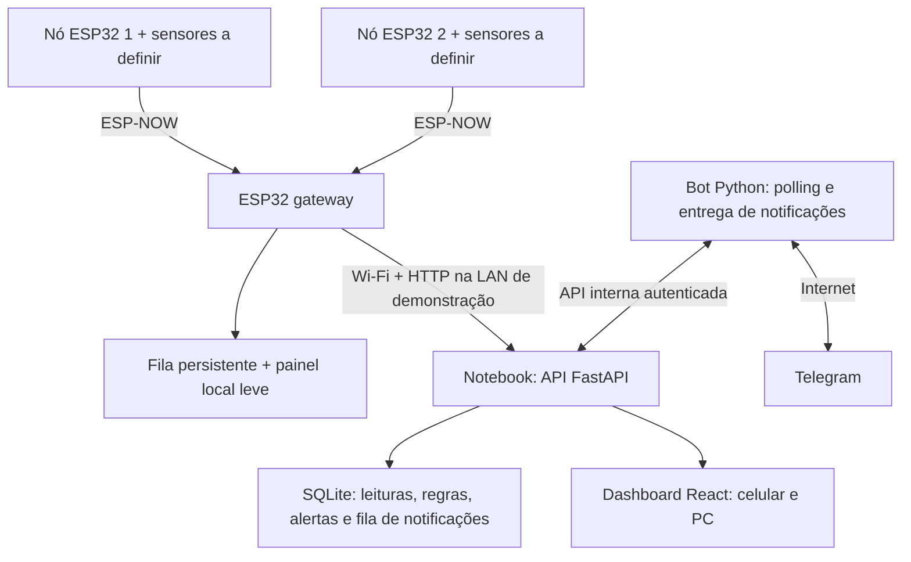

# Plano do projeto e organização da equipe

Documento central para os três desenvolvedores do hackathon. Reúne a arquitetura acordada, divisão de responsabilidades, fluxo de trabalho, etapas de entrega e contrato proposto de integração.

**Configuração acordada:** nós ESP32 → ESP-NOW → ESP32 gateway → FastAPI e SQLite no notebook local → dashboard React e bot Telegram. **Sensores e grandezas continuam em definição.**

O conteúdo descreve o planejamento da integração. Critérios de aceite e serviços futuros não devem ser confundidos com funcionalidades já validadas. Os registros de implementação de cada componente devem acompanhar seus respectivos READMEs.

- [Plano da equipe](#plano-da-equipe)
- [Contrato de integração v1](#contrato-de-integracao-v1)

<a id="plano-da-equipe"></a>

## Parte 1 — Plano da equipe

Decisões consolidadas em 12/11/2026. Documento de planejamento: API, banco de medições e firmware ainda não foram implementados neste workspace.

### 1. Escopo acordado

Três desenvolvedores, sensores ainda em definição, frontend React existente e bot Python já iniciado. O MVP terá nós ESP32 e uma ESP32 central (gateway), API FastAPI, SQLite no notebook, dashboard responsivo e Telegram para consultas, alertas e link do painel.

O notebook local foi escolhido pela equipe. Não será necessário PostgreSQL, broker MQTT ou infraestrutura de microsserviços para a primeira integração. O nome Ninhura aparece na proposta recente e AgroSponge RS identifica o código atual; confirmar a identidade de apresentação antes de renomear arquivos, bot ou publicação. Esta organização não altera a marca da aplicação.

Começar com um nó e um canal simulados; ampliar para dois nós e um gateway como alvo da demonstração se houver placas e tempo. Sensor escolhido depois altera aquisição, calibração e catálogo de perfis, sem mudar o fluxo principal.

### 2. Arquitetura e responsabilidades



| Parte | Responsabilidade |
| --- | --- |
| Nó | Aquisição, identificação da sessão/amostra, qualidade, envio e retransmissão limitada. |
| Gateway | Receber nós autorizados, identificar origem, persistir pendências, confirmar recepção e encaminhar à API sem bloquear a recepção. |
| API | Validar, deduplicar, persistir, consultar, avaliar regras e manter fila de notificações. |
| Bot | Consultar a API, responder ao chat autorizado, enviar notificações pendentes e informar resultado do envio. |
| Frontend | Apresentar perfis, leituras, comunicação, histórico e alertas calculados pelo backend. |

O token do Telegram fica apenas no processo do bot, no notebook. A API armazena ocorrências e o estado das notificações, mas não precisa expor o token aos outros componentes. Só a API acessa o banco; bot e frontend usam seus endpoints.

### 3. Divisão para três desenvolvedores

| Responsável | Área principal | Primeira entrega independente | Entrega integrada |
| --- | --- | --- | --- |
| Dev 1 | Backend + banco + regras | Ingerir o JSON do contrato, persistir e consultar. | Deduplicação, estado de alerta persistido e fila de notificações. |
| Dev 2 | Frontend + integração Telegram | Validar o frontend existente e preparar adaptador da API; comandos com respostas simuladas. | Dashboard usando API; `/status`, `/sensores`, `/alertas`, `/painel` e envio de alertas. |
| Dev 3 | Firmware dos nós + gateway | Nó produz dados simulados; gateway recebe e registra no serial. | ESP-NOW, fila persistente e envio HTTP no contrato. |

O Dev 2 tem duas interfaces sob responsabilidade porque já há código nas duas. Caso isso vire gargalo, o Dev 1 auxilia no cliente interno da API para notificações; a divisão é por interface de integração, não por isolamento absoluto. Atualizar o responsável no quadro de tarefas, sem duas pessoas editarem simultaneamente o mesmo arquivo.

O contrato em [contrato de integração v1](#contrato-de-integracao-v1) é a referência comum. O backend pode avançar com JSON simulado, o frontend com seu adaptador mock e o firmware com captura no serial. Nenhuma dessas frentes precisa aguardar a escolha dos sensores.

### 4. Pastas e colaboração Git

```text
PROJETO-HACKATON-2026/
  backend/                 # Futuro: API, banco, schemas, routers, serviços e testes
  bot/                     # Existente: evoluir o bot atual
  frontend/                # Existente: interface integrada em React/TypeScript
  firmware/                # Futuro
    sensor_node/
    gateway/
  docs/                    # Contrato, plano e roteiro da demonstração
  web/                     # Aplicação anterior, preservada durante a migração
  dashboard/               # Primeiro protótipo React, referência histórica
```

As pastas futuras ainda não significam serviços disponíveis. Trabalhar no repositório da equipe, sem novos repositórios Git dentro dessas pastas.

Concentrar novas telas em `frontend/`. `dashboard/` será referência histórica; `web/` permanece para compatibilidade e porque o novo frontend ainda importa `web/js/content.js`. Não excluir ou mover esse módulo sem atualizar a importação e validar o build. Evitar evoluir três versões de dashboard em paralelo.

Rotina recomendada: cada pessoa clona o repositório no próprio computador; branches curtas por entrega (`feat/api-ingestion`, `feat/frontend-api`, `feat/gateway-ingestion`); commits pequenos; pull request revisado por outra pessoa. Integrar uma entrega funcional por vez e buscar atualizações de `main` antes de iniciar a próxima. Não compartilhar a mesma branch para trabalho simultâneo.

Mudanças de endpoint, campo, unidade ou regra precisam atualizar contrato e exemplo no mesmo pull request, com aviso aos outros dois desenvolvedores. Conservar `package-lock.json` e usar `npm ci` para reproduzir a instalação. Não versionar `.env`, credenciais, banco SQLite de execução, `node_modules`, builds nem logs. A configuração de ignore dos novos serviços deve acompanhar sua implementação.

Usar um quadro simples: A fazer, Em andamento, Em revisão e Pronto. Cada tarefa registra responsável, dependência e um critério observável de aceite. Uma entrega está pronta quando o teste acordado passa e há instrução de execução, não apenas quando o arquivo foi criado.

### 5. Rede e execução no notebook

Configuração inicial: notebook, gateway e celular na mesma LAN de teste. Preferir roteador/hotspot controlado, canal estável e rádio compatível com a placa. Instalar dependências com antecedência em uma rede funcional: o Wi-Fi usado anteriormente teve timeout no npm; a rede móvel permitiu a instalação. A instalação é uma dependência da preparação, não da coleta local depois de tudo instalado.

| Serviço | Endereço previsto | Quem acessa |
| --- | --- | --- |
| API | `http://IP_DO_NOTEBOOK:8000` | Gateway, navegador do celular; bot pode usar loopback no notebook. |
| Dashboard em desenvolvimento | `http://IP_DO_NOTEBOOK:5173` | Navegadores do celular e PC. |
| Dashboard no ensaio final | Preferir build servido pelo backend no mesmo host | Reduz origens e simplifica o link do bot; implementação futura. |
| Telegram | Servidores externos | Processo do bot e aplicativo do usuário, com internet. |

Notebook executa API ouvindo na LAN, frontend e bot em terminais separados; não deixar suspensão automática interromper o ensaio. Firewall deve permitir apenas as portas necessárias na rede de teste. Configurar CORS com a origem exata do frontend de desenvolvimento, sem confundir CORS com autenticação do gateway.

`localhost` no celular aponta para o celular, não para o notebook. O link de `/painel` deverá usar o IP do notebook e só funcionará para clientes com acesso àquela LAN. Não se trata de um link público acessível de qualquer propriedade. Publicação HTTPS ou túnel autorizado será outra etapa, se necessária.

Para o link HTTP local, usar mensagem ou botão URL comum. O bot atual usa `WebAppInfo`, que exige URL HTTPS; portanto, a versão local não deve simplesmente trocar sua URL por HTTP mantendo o mesmo tipo de botão. Fonte: [Telegram WebAppInfo](https://core.telegram.org/bots/api#webappinfo).

O bot pode usar long polling sem endpoint público de webhook, mas continua dependendo de saída para internet. Deve haver somente um processo de polling por token, inclusive se já existir uma implantação do bot. Fonte: [Telegram getUpdates](https://core.telegram.org/bots/api#getupdates).

### 6. Operação sem internet e sem energia

| Falha | Resultado esperado |
| --- | --- |
| Internet externa cai, LAN e notebook continuam | Gateway ainda envia à API local; dashboard local continua; Telegram fica pendente. |
| API ou notebook indisponível | Gateway guarda pendências; painel do gateway permite consulta limitada. |
| Gateway perde roteador | Nós precisam continuar no mesmo canal do gateway; testar o modo de recuperação. |
| Rádio entre nó e gateway falha | Nó tenta novamente com os mesmos IDs; fila é limitada e perdas são sinalizadas. |
| Gateway reinicia | Registros já persistidos são recuperados e reenviados. |
| Nó reinicia | Não repetir identidade de sessão; fila apenas em RAM pode ser perdida. |

Na arquitetura de vários nós, armazenamento persistente e painel local ficam centralizados no gateway. Não é necessário hospedar um painel em cada nó. Persistência nos nós poderá ser acrescentada se for requisito sobreviver ao desligamento antes da recepção pelo gateway; não prometer essa garantia com fila em RAM.

O painel local do gateway, já previsto na arquitetura anterior, fica depois da primeira transmissão ponta a ponta na ordem de implementação. Histórico local é limitado pela flash; capacidade e política de armazenamento cheio devem ser explícitas.

### 7. Cuidados específicos do ESP-NOW

Os callbacks do rádio devem copiar dados para uma fila curta e retornar. Outra tarefa valida, grava e prepara o envio HTTP. Sucesso no envio de rádio não é confirmação de persistência: haverá ACK da aplicação após o gateway gravar, reutilizando a mesma identidade em retransmissões. A documentação oficial recomenda ACK e sequência quando é necessária confirmação de aplicação e orienta evitar operações demoradas nos callbacks. Fonte: [ESP-NOW](https://docs.espressif.com/projects/esp-idf/en/stable/esp32/api-reference/network/esp_now.html).

O protocolo de rádio será compacto, com versão, origem, sessão, sequência, canal e resultado. Não copiar cegamente o JSON HTTP completo para o pacote: dimensionar o payload para as placas e versão da biblioteca. Fixar a versão do Arduino core/ESP-IDF do time e documentar tamanho/serialização, sem depender do alinhamento de `struct` do compilador.

Nós e gateway precisam usar canal compatível; o gateway conectado ao roteador segue seu canal. Reconfigurar o roteador/hotspot pode exigir ajuste dos nós. Validar ESP-NOW e Wi-Fi HTTP simultâneos antes de distribuir o hardware no campo. Fonte: [ESP-NOW — configuração de peers e canais](https://docs.espressif.com/projects/esp-idf/en/stable/esp32/api-reference/network/esp_now.html).

### 8. Ordem das entregas

| Marco | Backend | Frontend/bot | Hardware | Aceite integrado |
| --- | --- | --- | --- | --- |
| A | Ingestão + consulta SQLite | Validar interface existente; cliente mock | Dados simulados no serial | Mesmo exemplo entendido pelas três frentes. |
| B | Listar nós/canais e últimas leituras | Dashboard consulta API | Gateway envia HTTP, inicialmente sem ESP-NOW | JSON aparece no histórico e no celular. |
| C | Deduplicação e sessões | Estados desatualizado/erro | Nó → ESP-NOW → gateway + fila | Reenvio não duplica; reinício não colide IDs. |
| D | Motor de alertas e outbox | Comandos + envio Telegram | Geração de condição experimental | Uma ocorrência persiste e gera aviso com link. |
| E | Recuperação e diagnósticos | Conferência no celular, PC e Telegram | Corte de rede e recuperação | Pendências sincronizam sem apresentar evento antigo como atual. |

Configuração pelo dashboard, autenticação multiusuário, mapa e previsões ficam fora do primeiro ensaio. O número “5/14 concluídas” da conversa anterior não é um inventário verificado deste repositório. O que há hoje é frontend demonstrativo e bot iniciado; API de medições e firmware continuam pendentes.

### 9. Critérios de aceite e demonstração

Receber, persistir e consultar uma leitura; enviar o mesmo registro duas vezes sem duplicar; reiniciar nó e gateway sem colisões; mostrar dois nós separadamente; diferenciar erro de sensor e falta de comunicação; gerar e recuperar um alerta experimental; reiniciar a API preservando estado; suspender Telegram sem bloquear ingestão; restaurar conexão e entregar resumo atrasado.

Roteiro curto: abrir dashboard no celular, mostrar pontos, alterar uma entrada simulada/física identificada, mostrar leitura recebida, provocar alerta experimental, receber mensagem com `/painel` e consultar `/status`. Se o Telegram não estiver acessível, mostrar ocorrência e notificação pendente sem alegar entrega.

As regras do ensaio serão demonstrativas. Não afirmar detecção de contaminantes específicos nem classificação agronômica oficial antes de escolher e validar sensores e método.

### 10. Próxima tarefa concreta

Implementar a ingestão e consulta da API usando o [contrato v1](#contrato-de-integracao-v1), enquanto o frontend prepara seu adaptador e o hardware produz o mesmo exemplo no gateway. Fazer a primeira integração com dados simulados antes de expandir sensores ou interface.

---

<a id="contrato-de-integracao-v1"></a>

## Parte 2 — Contrato de integração v1

Referência para implementação coordenada. Ainda não existe API correspondente neste workspace. Este documento atualiza os exemplos anteriores de `/api/measurements` para a arquitetura de nós + gateway e unifica o caminho em `/api/v1/readings`. Não há endpoint antigo implementado a migrar.

### 1. Identidade e catálogo

- `gateway_id`: central autenticada que encaminha os registros.
- `node_id`: ESP32 de origem, associado a uma área e a um gateway autorizado.
- `node_boot_id`: identificador único da inicialização do nó. Registros pendentes mantêm a sessão original ao serem retransmitidos; não usar a sessão do gateway no lugar.
- `sequence`: contador do ciclo de aquisição dentro dessa sessão, sem reutilizar sequência para outro ciclo.
- `sensor_id`: sensor físico ou simulado cadastrado no nó.
- `channel_id`: canal/grandeza de saída desse sensor. Um mesmo sensor pode produzir vários canais.
- `profile_id` + `profile_version`: definição imutável de tipo, unidade, categorias e apresentação.

A identidade única da leitura será `(node_id, node_boot_id, sequence, channel_id)`. Uma aquisição pode gerar vários canais, cada um uma leitura. Um reenvio conserva identidade e conteúdo de aquisição. O gateway pode mudar o lote HTTP sem mudar essa identidade.

Cadastrar gateway, nós, canais e perfis por seed/configuração inicial do backend; não criar cadastro público dinâmico no primeiro MVP. O cadastro resolve a área do nó e impede associar um token a nós arbitrários.

### 2. Requisição de ingestão

`POST /api/v1/readings`, com credencial específica do gateway em `Authorization: Bearer ...`. O ID do gateway deve corresponder à credencial, e os nós/canais precisam estar autorizados. Credenciais nunca aparecem no código do frontend.

Exemplo exclusivamente simulado, sem relógio absoluto confiável no nó:

```json
{
  "schema_version": 1,
  "gateway_id": "gateway-demo-01",
  "readings": [
    {
      "node_id": "node-demo-01",
      "node_boot_id": "boot-unico-001",
      "sequence": 42,
      "sensor_id": "sensor-demo-01",
      "channel_id": "signal-01",
      "profile_id": "signal-demo",
      "profile_version": 1,
      "result": { "kind": "numeric", "value": 42.5 },
      "quality": "valid",
      "source": "simulation",
      "measured_at": null,
      "time_quality": "unknown",
      "node_uptime_ms": 420000
    }
  ]
}
```

O valor deste exemplo é um índice fictício em `%`, definido no perfil. Não converter ADC em percentual sem calibração explícita. Para ADC bruto sem calibração, criar perfil com unidade de contagem; para manter ambos, usar canais/perfis distintos ou metadados brutos opcionais documentados.

### 3. Validação e horários

| Campo | Regra |
| --- | --- |
| `schema_version` | Exatamente 1; versão desconhecida é rejeitada. |
| `result.kind` | `numeric`, `categorical` ou `boolean`, conforme perfil versionado. |
| `result.value` | Número finito; código permitido; ou booleano real. Nunca aceitar `true` como número 1 por coerção. |
| `quality` | `valid` ou `sensor_error`. No erro, `result` é `null`. Zero e falso podem ser resultados válidos. |
| `source` | `simulation` ou `physical_sensor`; origem da amostra, independente do transporte. |
| `measured_at` | UTC ISO 8601 quando confiável; caso contrário `null`. |
| `time_quality` | `synchronized` ou `unknown` inicialmente; não marcar como sincronizado o relógio do nó só porque o gateway tem hora. |
| `node_uptime_ms` | Tempo desde a inicialização, útil para sequência relativa; não é data UTC. |
| `received_at` | Gerado pela API; não aceito como horário autoritativo de aquisição enviado pelo cliente. |

Validação do valor físico depende do perfil e calibração; domínio do gráfico não define automaticamente uma faixa física válida. O gateway pode acrescentar seu horário de recepção em um campo separado no futuro; não o apresentar como instante exato de aquisição.

### 4. Confirmação de lote e duplicação

No primeiro MVP, limitar lote a 32 registros e corpo HTTP a 32 KiB; são limites de aplicação propostos, a implementar e testar. O JSON HTTP é independente do tamanho do pacote ESP-NOW.

Autenticação inválida rejeita o envelope com 401/403. Envelope/JSON inválido retorna 422 sem processar registros; corpo acima do limite retorna 413. Envelope válido retorna 200 com resultado por leitura, inclusive para rejeições individuais. A API confirma somente depois do commit no banco.

```json
{
  "schema_version": 1,
  "gateway_id": "gateway-demo-01",
  "results": [
    {
      "node_id": "node-demo-01",
      "node_boot_id": "boot-unico-001",
      "sequence": 42,
      "channel_id": "signal-01",
      "status": "accepted",
      "reading_id": "id-gerado-pela-api"
    }
  ]
}
```

Status possíveis: `accepted`, `duplicate`, `rejected` e `conflict`. `duplicate` exige conteúdo de aquisição compatível com o registro existente; horários de transporte podem diferir. Conteúdo diferente sob a mesma chave gera `conflict`, sem sobrescrever silenciosamente. Rejeições incluem `error_code` e descrição curta, por exemplo perfil desconhecido ou tipo inválido.

O gateway marca como sincronizados somente `accepted` e `duplicate`. Rejeições/conflitos ficam em diagnóstico sem repetir indefinidamente o mesmo erro ou bloquear outros registros. Timeout, 429 e falhas 5xx exigem retry com atraso crescente e limite máximo; 401/403 exigem corrigir configuração, sem tentativas rápidas contínuas.

### 5. Endpoints previstos

| Método | Rota | Papel |
| --- | --- | --- |
| GET | `/health` | API e acesso básico ao banco; sem segredos. |
| POST | `/api/v1/readings` | Lote de aquisição autenticado por gateway. |
| GET | `/api/v1/readings` | Histórico filtrado e paginado. |
| GET | `/api/v1/devices` | Gateways e nós, com `role`, área e horários de comunicação conhecidos. |
| GET | `/api/v1/devices/{node_id}/latest` | Última leitura conhecida por canal e indicação de atualização. |
| GET | `/api/v1/profiles` | Catálogo versionado que define tipo e unidade. |
| GET | `/api/v1/alerts` | Ocorrências e estados. |
| POST | `/api/v1/gateways/{gateway_id}/heartbeat` | Estado do gateway e, quando conhecido, sessões atuais dos nós. |

Histórico: filtros `node_id`, `channel_id`, `from`, `to`, `limit` (padrão 100, máximo 500) e `cursor` opaco; resposta `{items: [...], next_cursor: null|string}`. Ordenação estável por aquisição conhecida e ID de desempate; incluir filtro explícito `time_quality=unknown` para consultar registros sem horário, sem descartá-los silenciosamente. Catálogo retorna `{items: [...]}`. Dispositivos e alertas usam o mesmo envelope de lista; alertas também devem ser paginados.

Cada leitura de resposta expõe `id`, identificadores de origem, perfil, resultado, qualidade, origem, horários e sessão. Últimas leituras retornam `{node_id, channels: [{channel_id, reading, freshness}]}`; `reading` pode ser `null`. O backend calcula a recência: sequência é comparável dentro de uma sessão, mas não entre inicializações. Não ordenar UUIDs de sessão nem usar horário de upload para afirmar qual coleta foi mais recente.

Quando o gateway informa a sessão atual pelo heartbeat, a API distingue essa sessão das pendências antigas. Se não houver evidência suficiente para ordenar sessões sem relógio, sinalizar incerteza na recência; não transformar uma hipótese em status atual. Recepção de um lote antigo não atualiza o horário de última coleta do nó. Registrar separadamente última comunicação do gateway, último contato de rádio informado e última aquisição conhecida.

### 6. Adaptação ao frontend existente

O frontend atual é mock e usa camelCase/epoch em milissegundos. Criar adaptador explícito: `node_id → deviceId`, `sensor_id → sensorId`, `profile_id → profileId`, `profile_version → profileVersion`, datas ISO → epoch, preservando `null`. Acrescentar `channelId`, `gatewayId` e `nodeBootId` ao modelo de domínio antes de conectar múltiplos nós/sessões.

O modelo de perfil já existente pode ser usado no catálogo com normalização dos nomes no adaptador. Não criar duas listas divergentes de unidades no frontend e backend. O catálogo da API será a referência para dados reais; mocks mantêm seus perfis simulados separados.

Substituir o cálculo local `latest()` para dados reais pela recência fornecida pela API, sem comparar contadores de nós ou sessões diferentes. Atualizar cartões e filtros para selecionar nó + canal. Seleção por perfil, sozinha, não identifica qual ponto foi medido.

Usar `VITE_API_BASE_URL` configurável no desenvolvimento ou `/api/v1` na futura publicação sob o mesmo host. No celular, nunca embutir `localhost` como host da API do notebook. Falha na API gera estado de erro/desatualização; não ativa mock automaticamente.

### 7. Persistência e alertas

Entidades mínimas propostas: gateways, nós, canais/perfis, leituras, regras, ocorrências e outbox de notificações. Podem ser implementadas com poucas tabelas e configuração seed, mas o estado que precisa sobreviver a reinício deve ser persistido. Três tabelas isoladas de dispositivo/leitura/alerta não cobrem sozinhas configuração e retentativas confiáveis.

SQLite será acessado apenas pela API. Credenciais e chat autorizado ficam em configuração de ambiente; um único chat de demonstração é suficiente no MVP. PostgreSQL é evolução futura, sem implementar dois bancos simultaneamente.

Regras numéricas iniciais: limite, direção, quantidade consecutiva e margem de recuperação explícitos por canal. Guardar contadores e estado ativo; persistir ocorrência e notificação na mesma transação. Leitura duplicada não conta novamente. Qualidade inválida não conta como leitura normal e interrompe a sequência; intervalo máximo e troca de sessão também precisam ser tratados. Regra sem configuração não produz avaliação “normal”.

Primeiro integrar coletas em ordem. Para lotes atrasados, não avançar o estado atual ao reprocessar dados anteriores ao último registro avaliado: arquivar o histórico e identificar pendência de avaliação/reprocessamento; não anunciar alertas antigos como atuais. Uma síntese histórica exige avaliação cronológica separada. Explicitar esse limite na demonstração inicial em vez de aplicar uma regra incorreta.

O bot requisita notificações à API interna com token próprio: operação de reserva/lease, envio ao Telegram e confirmação de entregue/falha. Endpoints internos e duração da reserva serão definidos pelo Dev 1 e Dev 2 antes dessa etapa; não publicar uma fila de envios sem autenticação. API nunca espera a resposta do Telegram para aceitar uma medição. Entrega exatamente uma vez não é garantida em falha entre envio e confirmação.

Comandos: `/start`, `/status`, `/sensores`, `/alertas`, `/painel`, `/ajuda`. Somente chat permitido consulta os dados de demonstração. Nenhum comando controla remotamente o hardware nesta etapa.

### 8. Primeiro teste compartilhado

1. Backend recebe o exemplo simulado e retorna `accepted`.
2. O mesmo registro retorna `duplicate` e permanece uma única linha de medição.
3. Mesmo registro com valor alterado retorna `conflict`.
4. Novo `node_boot_id` com sequência reiniciada é aceito sem colisão.
5. Catálogo e histórico são interpretados pelo adaptador do frontend.
6. Segundo nó com mesmo contador não se mistura ao primeiro.
7. Hora desconhecida permanece desconhecida na tela e na exportação.

Esses são critérios para implementação e revisão dos três desenvolvedores, não testes já executados de uma API disponível.
