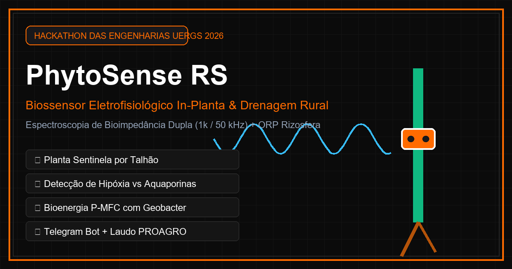
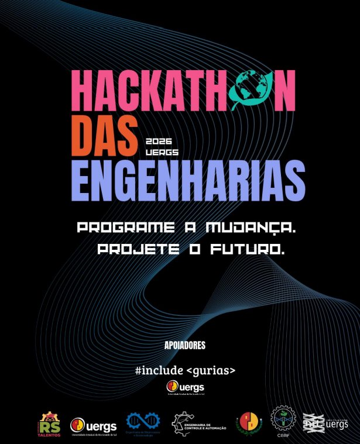

<div align="center">



# 🌱 AgroSponge RS
### Biossensor de Enxurrada & Guarda d'Água para a Agricultura Familiar

[](https://github.com/brunoluiztv/PROJETO-HACKATON-2026)
[-00e5ff?style=for-the-badge&logo=github)](https://brunoluiztv.github.io/PROJETO-HACKATON-2026/)
[](bot/)
[](docs/ACESSIBILIDADE-UX.md)
[](LICENSE)

<p align="center">
  <strong>“PROGRAME A MUDANÇA. PROJETE O FUTURO.”</strong><br>
  <em>Projeto desenvolvido no Hackathon das Engenharias UERGS 2026</em>
</p>

[🌐 Acessar Web App Online](https://brunoluiztv.github.io/PROJETO-HACKATON-2026/) • [🤖 Configurar Bot](docs/CONFIGURACAO-TELEGRAM.md) • [♿ Guia de Acessibilidade](docs/ACESSIBILIDADE-UX.md) • [📋 Resumo do Projeto](docs/CHAT-ANTIGRAVITY.md)

---

</div>

## Desenvolvimento e documentação consolidada

Este repositório fica em `hackathon/PROJETO-HACKATON-2026/` e inclui o protótipo React anterior em `dashboard/`. Seus demais caminhos internos permanecem os mesmos.

O [relatório geral e análise do código](docs/RELATORIO-PROJETO.md) registra o estado verificável da implementação e as decisões de evolução: ESP32 com armazenamento local, painel web local, dashboard remoto e Telegram. **Sensores e grandezas continuam em definição.** A aplicação web e o bot abaixo já têm código; a integração com ESP32 e API de medições é uma próxima etapa.

O [plano do frontend adaptável](docs/PLANO-FRONTEND-ADAPTAVEL.md) compara as interfaces existentes e propõe uma versão configurável por tipo de análise, com etapas de migração e critérios de validação.

A primeira implementação está em **[frontend/](frontend/README.md)**: monitoramento responsivo com perfis numéricos, categóricos e booleanos, dados simulados, histórico, CSV e conteúdos da equipe. Para executar: `cd frontend`, `npm install` e `npm run dev`. A instalação neste ambiente foi bloqueada por DNS; build e validação visual ainda estão pendentes. A versão em `web/` continua preservada.

## 📌 Contexto & Desafio

O Rio Grande do Sul enfrenta a alternância violenta entre **enxurradas extremas** e **estiagens severas**. O pequeno produtor familiar perde sua produção tanto pelo excesso quanto pela falta d'água, sem ter ferramentas acessíveis para armazenar água das chuvas de maneira segura ou para saber se a água recolhida está contaminada.

O **AgroSponge RS** resolve essa dor com uma tecnologia social de baixo custo (cerca de **R$ 5,80 por saco**) associada a um ecossistema digital inclusivo:
1. **Saco de Algodão Cru Filtrante**: recheado com 700g de casca de arroz e carvão ativado moído, 250g de goma vegetal gelificante e 50g de tanino de acácia com fungo protetor (*Trichoderma*).
2. **Biossensor Colorimétrico**: fitinha selo reativa colada no saco que indica visualmente a qualidade da água retida.
3. **Assistente Digital Multiplataforma**: Bot de Telegram empático e acessível por áudio/foto + Web App PWA que funciona sem internet no campo + Extensão de acessibilidade para produtores com baixa visão, dislexia ou dificuldades de leitura.

---

## 🎨 Selo Colorimétrico: Como Funciona

| Selo | Condição da Água | O que fazer | Vantagem para a Roça |
|:---:|:---|:---|:---|
| 🟢 **VERDE** | **Água Limpa** | Cortar o saco de algodão com a enxada e misturar o gel direto nos canteiros de verdura, milho ou feijão. | Guarda **13 litros de água** em gel por saco e protege as raízes na estiagem com *Trichoderma*. |
| 🟡 **AMARELO** | **Água com Barro** | Não colocar em hortaliças folhosas. Deixar descansar na composteira por 15 dias ou usar no pé de árvores frutíferas e acácia. | O calor do monte de adubo higieniza a matéria orgânica antes do uso. |
| 🔴 **VERMELHO** | **Perigo / Contaminada** | **PROIBIDO abrir na horta.** Manter o saco fechado e usar na contenção de barrancos ou encostas. | O carvão ativado aprisionou óleos e coliformes, protegendo o lençol freático e o poço. |

> 🛡️ **Segurança em Primeiro Lugar**: O bot utiliza visão computacional com recorte central (ROI 30%). Se a iluminação for precária ou a cor não for conclusiva, o algoritmo **nunca chuta verde**. Ele aciona o modo de segurança e oferece botões táteis para confirmação.

---

## 🏗️ Estrutura do Ecossistema

```
PROJETO-HACKATON-2026/
├── assets/                          # Identidade visual oficial do Hackathon UERGS 2026
│   ├── hackathon-poster.jpg         # Pôster original do evento
│   └── social-preview.png           # Banner OpenGraph em alta resolução
├── bot/                             # Assistente AgroSponge para Telegram
│   ├── agrosponge_telegram_bot.py   # Entrada principal com polling
│   ├── classificador.py             # Visão computacional RGB com fail-safe
│   ├── conteudo.py                  # Textos acolhedores e laudos técnicos
│   ├── roteamento.py                # Processamento de linguagem natural simplificado
│   ├── setup_telegram_bot.py        # Configuração automática de comandos e Menu WebApp
│   ├── assets/                      # Avatar oficial 512x512 para o @BotFather
│   ├── Dockerfile & railway.json    # Infraestrutura para deploy contínuo 24/7 na Railway
│   └── tests/                       # Suite de testes unitários (pytest)
├── web/                             # Web App PWA Mobile-First
│   ├── index.html                   # Estrutura semântica acessível (WCAG 2.2 AA)
│   ├── css/styles.css               # Design tokens, temas claro/escuro e alvos >= 48px
│   ├── js/                          # Calculadora de estiagem e gráficos vetoriais SVG
│   ├── manifest.webmanifest         # Configuração de instalação PWA
│   └── sw.js                        # Cache-first offline para uso sem sinal no campo
├── extension/                       # Extensão de Acessibilidade Web (Manifest V3)
│   ├── popup.html & popup.js        # Painel flutuante (Alt+A) com controles inclusivos
│   └── content.js & content.css     # Ampliação de texto, modo dislexia e voz pt-BR
└── docs/                            # Documentação técnica e registros de projeto
    ├── CONFIGURACAO-TELEGRAM.md     # Guia prático para BotFather, Mini App e setup
    ├── ACESSIBILIDADE-UX.md         # Checklist ergonômico e boas práticas de UX
    └── CHAT-ANTIGRAVITY.md          # Histórico de decisões de engenharia
```

---

## 🚀 Como Executar

### 1. Web App PWA (Navegador ou Celular)
O Web App já está publicado em HTTPS no GitHub Pages:
👉 **[https://brunoluiztv.github.io/PROJETO-HACKATON-2026/](https://brunoluiztv.github.io/PROJETO-HACKATON-2026/)**

Para rodar localmente:
```bash
cd web
python -m http.server 8080
# Abra http://localhost:8080 no navegador
```

### 2. Bot do Telegram
```bash
cd bot
# 1. Ativar o ambiente virtual Python
python -m venv .venv
.\.venv\Scripts\activate   # No Linux/macOS: source .venv/bin/activate

# 2. Instalar dependências
pip install -r requirements.txt

# 3. Configurar seu token
copy .env.example .env
# Adicione seu TELEGRAM_TOKEN gerado no @BotFather

# 4. Configurar comandos e botão de menu no Telegram automaticamente
python setup_telegram_bot.py

# 5. Iniciar o assistente
python agrosponge_telegram_bot.py
```
> Para rodar os testes unitários de segurança: `pytest -v`

### 3. Extensão de Acessibilidade (Chrome ou Edge)
1. Acesse `chrome://extensions` ou `edge://extensions` no navegador.
2. Ative o **Modo do Desenvolvedor** no canto superior direito.
3. Clique em **Carregar sem compactação** e selecione a pasta `extension/`.
4. Abra o Web App e aperte `Alt + A` para controlar o tamanho da fonte, modo dislexia e leitura em voz alta.

---

## ♿ Destaques de UX & Acessibilidade

- **Design para o Polegar**: Toda a navegação e botões principais estão concentrados na parte inferior da tela, facilitando a operação com uma só mão na lavoura.
- **Áreas de Toque Generosas**: Alvos interativos com altura mínima de 48px, prevenindo toques acidentais por mãos calejadas ou com luvas de trabalho.
- **Dupla Codificação da Informação**: A cor nunca é o único indicador. O selo combina **cor de alto contraste + símbolo geométrico (✔, !, ✖) + texto em caixa alta**.
- **Autonomia Offline**: O Service Worker armazena em cache todos os recursos essenciais. O agricultor pode consultar laudos e calcular a água necessária mesmo sem conexão 4G ou Wi-Fi.

---

## 🤝 Realização & Apoiadores

<div align="center">

Projeto concebido para o **Hackathon das Engenharias UERGS 2026**



**Apoiadores & Entidades:**
`#include <gurias>` • `Universidade Estadual do Rio Grande do Sul (UERGS)` • `RS Talentos` • `Engenharia de Bioprocessos e Biotecnologia` • `Engenharia de Controle e Automação` • `CARF` • `NIT UERGS`

</div>

---

<p align="center">
  Desenvolvido com carinho para fortalecer a resiliência climática das famílias agricultoras do Rio Grande do Sul.
</p>
