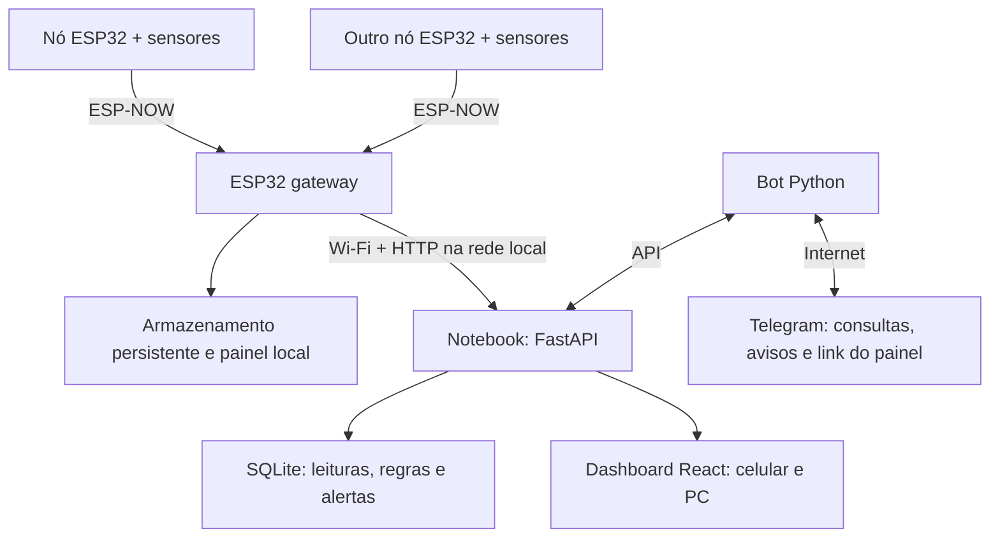

# Plataforma IoT de Monitoramento para Agricultura Familiar

Projeto desenvolvido no **Hackathon das Engenharias UERGS 2026** por uma equipe de três desenvolvedores. O objetivo é coletar medições em pontos distribuídos, armazenar o histórico e permitir ao agricultor consultar informações pelo celular, computador e Telegram.

**O nome definitivo do projeto, os sensores e as grandezas a medir estão em definição.** A arquitetura permite adaptar a apresentação dos resultados sem vincular todo o sistema a um único sensor.

## Documentação principal

Comece pelo **[PLANO-DO-PROJETO.md](PLANO-DO-PROJETO.md)**, na raiz do repositório. Ele reúne:

- Arquitetura e responsabilidades dos componentes.
- Divisão de trabalho dos três desenvolvedores e organização Git.
- Contrato proposto de integração da API.
- Etapas de entrega, critérios de aceite e roteiro de demonstração.

Documentos complementares: [plano do frontend adaptável](docs/PLANO-FRONTEND-ADAPTAVEL.md), [relatório técnico](docs/RELATORIO-PROJETO.md) e [instruções do frontend](frontend/README.md). Registros anteriores são mantidos para consulta; o plano central descreve a arquitetura acordada para a integração.

## Arquitetura do MVP



Os nós coletam e transmitem. O gateway recebe os dados, mantém pendências e encaminha à API. O backend valida, armazena e avalia regras; dashboard e bot consultam a mesma fonte de dados. O token do Telegram permanece no notebook.

A configuração inicial utiliza **notebook local**, com FastAPI e SQLite. O armazenamento e o painel embarcados serão centralizados no gateway. As funcionalidades planejadas ainda precisam ser integradas e validadas.

## Estado do desenvolvimento

| Componente | Situação |
| --- | --- |
| Frontend integrado | Implementado em `frontend/`, com dados simulados e perfis numéricos, categóricos e booleanos. |
| Histórico e exportação | Gráficos, tabela, períodos e CSV disponíveis na demonstração do frontend. |
| Bot Telegram | Código inicial existente; comandos de monitoramento e integração com a API ainda precisam ser concluídos. |
| Hardware | Sketches iniciais disponíveis em `ESPs32 - Hard/`; integração com o contrato e ensaio completo precisam ser validados. |
| API e banco de medições | Planejados; implementação pendente neste repositório. |
| Fila persistente, sincronização e alertas | Especificados no plano; validação integrada pendente. |
| Sensores e critérios de análise | Em definição. |

O frontend ainda não está conectado a medições físicas. Os exemplos apresentados são simulações, sem comprovação de concentração, contaminação ou classificação agronômica. Critérios reais dependem da escolha dos sensores, calibração e validação do método.

Alguns arquivos e conteúdos herdados ainda usam a identidade e a proposta anteriores. Sua existência preserva o histórico de desenvolvimento; a apresentação atual do projeto é a plataforma de monitoramento descrita neste README. A adaptação da interface e do bot será feita nas próximas entregas.

## Organização do repositório

```text
PROJETO-HACKATON-2026/
├── README.md
├── PLANO-DO-PROJETO.md       # Referência central da equipe e contrato da API
├── frontend/                # Interface integrada em React, TypeScript e Vite
├── bot/                     # Bot Python e testes existentes
├── ESPs32 - Hard/           # Sketches iniciais do nó e da central
├── docs/                    # Relatórios, planos e registros técnicos
├── web/                     # Aplicação anterior e conteúdo reutilizado
├── dashboard/               # Primeiro protótipo React, referência histórica
├── extension/               # Extensão de acessibilidade existente
└── assets/                  # Materiais de apresentação existentes
```

Concentrar novas telas em `frontend/`. Essa aplicação ainda importa conteúdo de `web/js/content.js`; preservar esse arquivo até concluir sua adaptação. A estrutura futura de backend e firmware está detalhada no plano central.

## Executar o frontend

Com Node.js e npm instalados, a partir da raiz do repositório:

```bash
cd frontend
npm ci
npm run dev
```

Abra o endereço **Local** informado pelo Vite, normalmente `http://localhost:5173`. Mantenha o terminal aberto.

Para acessar pelo celular, conecte celular e notebook à mesma rede e abra o endereço **Network** informado pelo Vite. `localhost` no celular aponta para o próprio celular.

Para verificar e gerar o build:

```bash
npm test
npm run build
npm run preview
```

O build gera `frontend/dist/`. O roteiro de validação está no [README do frontend](frontend/README.md). A instalação exige acesso ao servidor de pacotes npm; houve timeout no Wi-Fi usado durante o desenvolvimento, enquanto a conexão móvel permitiu prosseguir.

## Bot Telegram

O código inicial e seus requisitos estão em [bot/](bot/). Para preparar o ambiente em Linux/macOS:

```bash
cd bot
python3 -m venv .venv
source .venv/bin/activate
pip install -r requirements.txt
cp .env.example .env
```

Preencha o token e a URL apropriada em `.env`, sem versionar credenciais. O [guia existente](docs/CONFIGURACAO-TELEGRAM.md) documenta a configuração inicial; textos, comandos e identidade ainda precisam ser adaptados à plataforma atual.

O MVP prevê `/start`, `/status`, `/sensores`, `/alertas`, `/painel` e `/ajuda`, além de envio de alertas com link do dashboard. O estado da ocorrência e as retentativas de notificação deverão ser persistidos pela API.

No ensaio local, `/painel` deve enviar um link comum com o IP do notebook. O botão Mini App da implementação anterior exige HTTPS e precisa de tratamento diferente para um endereço HTTP local. Esse link local não é acessível fora da rede do notebook.

## Funcionamento sem internet

- Se a internet externa cair, mas a rede local e o notebook continuarem funcionando, a coleta, a API e o dashboard local poderão continuar após a integração.
- Se o notebook ou a API estiver indisponível, o gateway deverá armazenar pendências para sincronização posterior.
- O painel local leve do gateway permitirá consulta próxima, dentro da retenção disponível.
- Telegram depende de internet; falhas de envio não devem bloquear aquisição e persistência.
- Dados apenas em RAM nos nós podem ser perdidos após desligamento. Garantias de retenção exigem armazenamento persistente e teste.

## Próximas entregas

1. Implementar ingestão e consulta da API conforme o contrato central, usando JSON simulado.
2. Conectar o frontend à API com seleção de nó e canal.
3. Integrar nó, gateway, armazenamento e reenvio sem duplicações.
4. Implementar regras experimentais, persistência de ocorrências e notificações Telegram.
5. Escolher e calibrar sensores, adaptando seus perfis de análise.
6. Validar o fluxo completo no celular e PC, incluindo interrupção e recuperação de conexão.

Cada desenvolvedor trabalha em branch própria, com entregas pequenas e revisão por outro membro. Alterações no contrato devem acompanhar a documentação e ser combinadas com a equipe.
