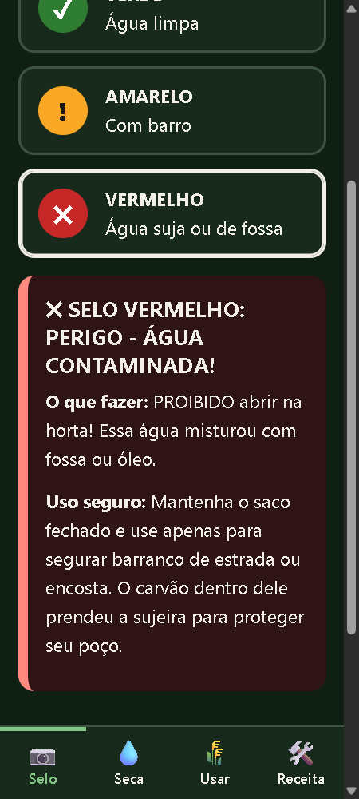

# UX e acessibilidade aplicados

Referência: WCAG 2.2 AA (com partes AAA), Material Design e boas práticas de mobile-first.

## Site (`web/`)
| Prática | Onde |
|---|---|
| CSS mobile-first (360 px; `min-width` só para tablet/desktop) | `css/styles.css` |
| Alvos de toque ≥ 48 px (`--toque: 3rem`) e espaçamento entre eles | `.cor`, `.mais-menos`, `.nav-inferior a` |
| Navegação inferior (zona do polegar), `aria-current` na aba ativa | `.nav-inferior` |
| Texto base de 18 px em `rem`, `clamp()` nos títulos, respeita zoom | `html`, `h1` |
| Cor nunca é a única informação (cor + ícone + texto) | cartões de selo e laudos |
| Contraste ≥ 4.5:1, tema escuro (`prefers-color-scheme`), `prefers-contrast` | `:root` |
| Landmarks, ordem de títulos, skip-link, foco visível, `aria-live` nos resultados | `index.html` |
| Gráfico SVG com alternativa em tabela | `#grafico` + `#tabela` |
| `prefers-reduced-motion` | fim do CSS |
| Sem framework e sem CDN (só `telegram-web-app.js`, opcional) | `js/` |
| PWA: manifest + service worker (rede ruim no campo) | `manifest.webmanifest`, `sw.js` |
| CSP sem scripts/estilos inline | `netlify.toml` |
| Linguagem simples, verbo no botão, reconhecimento em vez de memorização | todo o texto |

## Extensão (`extension/`)
Texto de 100% a 200%, alto contraste, modo escuro, foco destacado, fonte e espaçamento para dislexia (WCAG 1.4.12), sem animações e leitura em voz alta pt-BR. Atua só no domínio do site (permissões mínimas). O popup tem rótulos claros, `aria-pressed` e navegação por teclado.

## Bot (`bot/`)
Teclado fixo com botões grandes, respostas curtas e acolhedoras, aceita áudio e foto, e não exige digitar. Na dúvida, não conclui e pede confirmação.

---

## 📱 Relatório de Validação Mobile Estrita (360×800)

Em atendimento às diretrizes do Hackathon UERGS 2026 e aos critérios de usabilidade no campo, foi executada uma rodada de testes em viewport estritamente de **360×800 px** (dimensão típica de smartphones de entrada com uma mão):

| Teste | Critério Avaliado | Resultado | Observações |
|---|---|:---:|---|
| **Aba Selo** | Responsividade sem rolagem horizontal | **APROVADO** | `scrollWidth <= 360px`, margens de toque confortáveis e laudo em alto contraste. |
| **Aba Seca** | Simulação 80 sacos = 18 dias | **APROVADO** | Atalho "Sítio · 80" calculou exatamente `1.040 L` e `cerca de 18 dias sem regar`, com valor idêntico na tabela de acessibilidade. |
| **Aba Receita** | Bordas coloridas e rodapé do evento | **APROVADO** | Bordas com `.i1` (verde), `.i2` (amarelo) e `.i3` (roxo) com identificação reforçada. Rodapé comemorativo do Hackathon UERGS 2026 visível no fim da rolagem sem conflito com a barra inferior. |
| **Aba Usar** | Expansão de FAQ com leitor de tela | **APROVADO** | Accordions semânticos nativos (`
/
`) totalmente funcionais. |

Evidência visual capturada em viewport mobile de 360px:

