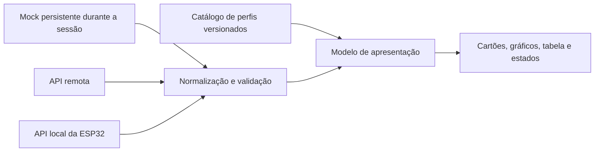

# Plano para um frontend adaptável ao tipo de análise

Atualização de topologia: a equipe adotou nós ESP32 + gateway + API no notebook. Antes de conectar a interface, implementar seleção de nó/canal e adaptação das sessões/recência conforme o [contrato v1](CONTRATO-API-V1.md). O [plano da equipe](PLANO-EQUIPE-MVP.md) organiza os responsáveis e marcos.

Data da proposta: 12 de novembro de 2026.

**Estado em 13/11/2026:** a interface atual em `frontend/` oferece modos API e demonstração, com testes e build aprovados conforme seu README. Os protótipos comparados abaixo estão preservados em `legacy/web/` e `legacy/dashboard/`. A dependência de `web/js/content.js` já foi removida. O [registro da organização](ORGANIZACAO-REPOSITORIO.md) descreve os caminhos atuais; as propostas abaixo registram a evolução inicial.

Atualização de implementação: a primeira versão do núcleo e da interface está em [frontend/](../frontend/README.md), com quatro perfis de exemplo, cenários, gráficos, tabela, CSV e conteúdos da equipe. A consulta à API foi implementada depois dessa proposta. Cache persistente, painel na ESP32 e ensaio integrado no celular continuam pendentes. O restante deste documento registra o plano e seus critérios de evolução.

## 1. Direção proposta

Construir uma experiência de monitoramento orientada por **perfis de análise**, aproveitando a interface de acompanhamento do dashboard React e a navegação simples, a identidade e a integração com Telegram da aplicação da equipe. A escolha do sensor ficará na configuração e na aquisição dos dados, sem aparecer como pressuposto em cada componente da interface.

O resultado inicial deve funcionar com dados simulados. Posteriormente, o mesmo modelo de apresentação receberá dados da API. A versão local da ESP32 seguirá o mesmo contrato e as mesmas convenções visuais, com uma interface menor e recursos locais. Não é necessário embarcar o build React completo para oferecer a mesma experiência básica.

Os sensores, as grandezas e os métodos de análise continuam em definição. Temperatura, sinal percentual, presença/ausência e classificação de cor são exemplos para exercitar o modelo, não decisões de hardware nem equivalências entre métodos.

## 2. Comparação dos frontends existentes

| Aspecto | Equipe: `web/` | Protótipo: `dashboard/` | Decisão proposta |
| --- | --- | --- | --- |
| Tecnologia | HTML, CSS e módulos JavaScript, sem etapa de build. | React, TypeScript e Vite. | React + TypeScript no monitoramento remoto; HTML/JS leve no painel embarcado. |
| Uso atual | Selo, calculadora, orientações e receita. | Leituras simuladas, histórico, alertas e dispositivo. | Aproveitar o acompanhamento do React; preservar os módulos da equipe. |
| Navegação | Abas inferiores com rótulos no celular. | Barra lateral no PC; atalhos viram ícones no celular. | Abas com texto no celular e navegação lateral no PC. |
| Gráfico | Barras de cenários calculados. | Série temporal SVG. | Escolher representação pelo tipo de resultado. |
| Dados | Constantes e seleção manual. | Histórico gerado na memória. | Adaptadores de dados e identidade estável das leituras. |
| Dependência de análise | Selo e estimativas de água fixos. | Percentual, ADC e regra de 30% fixos. | Perfil versionado com unidade, escala, categorias e regra opcional. |
| Telegram | Integração opcional com WebApp e links `?lote=...`. | Compartilha a URL do painel. | Integrar a experiência atual do Telegram ao novo monitoramento e preservar links existentes. |
| Offline | Service worker e cache de arquivos estáticos. | Sem persistência ou service worker. | Distinguir cache remoto, consulta local à ESP32 e sincronização de medições. |
| Acessibilidade | Texto + símbolo + cor, link de salto e tabela de dados. | Estados visuais e foco, mas gráfico depende de ponteiro e modal limita Tab. | Reaproveitar semântica e tabela; garantir teclado, toque e foco em toda a interface. |

Essa é uma análise de código, sem inspeção visual ou comprovação de conformidade de acessibilidade nesta etapa.

## 3. O que precisa ser desacoplado

No React, `Reading` obriga `value` e `raw` numéricos; `Chart` divide valores por 100, presume dados não vazios e desenha um limiar único. A interface usa `%`, “umidade” e “ADC” em vários pontos. `exportReadings` fixa a origem e os nomes das colunas. O estado de alerta depende do cenário selecionado, não de ocorrências recebidas.

O filtro `readings.slice(-(period * 12 + 1))` presume doze amostras por hora. O próximo frontend deve filtrar pelo horário real, porque sensores podem coletar em intervalos diferentes e a rede pode entregar lotes atrasados. `createReadings` recria todo o histórico ao atualizar; os novos mocks devem preservar registros anteriores e acrescentar amostras com identificadores estáveis.

Na aplicação da equipe, `content.js` contém orientações e constantes ligadas ao selo e aos sacos. Esses conteúdos poderão continuar como módulos específicos. Não devem virar interpretação automática de qualquer sensor novo. O SDK externo do Telegram será opcional e não poderá ser requisito para consultar o painel local.

## 4. Modelo: sensor, análise e leitura são elementos diferentes

| Elemento | O que representa | Exemplos de campos |
| --- | --- | --- |
| Dispositivo | Unidade que coleta e sincroniza. | ID, área, última comunicação, armazenamento e pendências. |
| Sensor | Hardware ou origem de aquisição. | ID, modelo quando definido, canais e calibração. |
| Perfil de análise | Como uma grandeza ou resultado é apresentado e interpretado. | ID, versão, nome, tipo, unidade, escala e regra opcional. |
| Leitura | Resultado obtido em um instante ou sequência. | Identidade, canal, perfil, valor, qualidade, origem e horário. |
| Ocorrência | Resultado da avaliação de uma regra. | Regra e versão, leituras de referência, abertura e encerramento. |

Um sensor poderá produzir várias grandezas. Uma análise derivada de vários canais exigirá método, entradas e versão próprios; não será uma simples troca do título do cartão. Para o MVP, começar com apresentação direta de canais, sem um mecanismo genérico de fórmulas.

### Tipos de resultado

| Tipo | Apresentação | O que evitar |
| --- | --- | --- |
| Numérico | Valor com unidade; linha temporal ou pontos; mínimo, máximo e média quando adequados. | Escala percentual universal e mistura de unidades no mesmo eixo. |
| Categórico | Rótulo + símbolo + cor; eventos em sequência e contagem por categoria. | Média numérica de categorias e uso apenas de cor. |
| Booleano | Estado explícito, como detectado/não detectado, e histórico de mudanças. | Confundir ausência de detecção com erro de aquisição. |

Uma foto pode servir de evidência anexada a um resultado; imagem e classe calculada não são a mesma informação. A categoria detectada em uma foto, sozinha, não prova concentração ou contaminação. A equivalência depende do método validado que a equipe escolher.

### Exemplo de perfil numérico demonstrativo

```json
{
  "id": "sinal-demo",
  "version": 1,
  "label": "Sinal demonstrativo",
  "kind": "numeric",
  "unit": "%",
  "decimals": 1,
  "displayDomain": { "min": 0, "max": 100 },
  "chart": "line",
  "rule": null
}
```

O perfil configura a exibição. Validação física e conversão de leitura bruta pertencem ao firmware/API e precisam de calibração. Faixa de desenho não é faixa física permitida: um valor fora do eixo não deve ser ocultado nem limitado silenciosamente. Se a unidade mudar, o sistema deve converter por método explícito ou separar séries, nunca apenas trocar o rótulo.

Para um perfil categórico, `kind` será `categorical`, sem unidade ou domínio numérico, e haverá uma lista de códigos e rótulos. O registro de leitura apontará para `profile_id` e `profile_version`. Alterações em calibração e regra também terão referências próprias para manter a interpretação do histórico.

### Evolução do contrato de leitura

O exemplo do [relatório geral](RELATORIO-PROJETO.md) é o ponto de partida numérico. Antes da implementação, formalizar tipos distintos de leitura: numérica com valor finito, categórica com código autorizado e booleana com valor lógico. O contrato deve associar canal e perfil versionado e validar o valor de acordo com esse tipo.

Campos comuns: identificação da leitura, dispositivo, sensor/canal, área, origem, qualidade, horário de aquisição quando conhecido, horário de recebimento e qualidade do horário. Leitura bruta e calibração são opcionais. `null` com erro representa ausência de resultado válido; zero e `false` continuam sendo resultados possíveis. Perfil desconhecido deve gerar apresentação básica e aviso de interpretação indisponível, sem aplicar a regra de outro sensor.

## 5. Interface proposta

No celular: navegação inferior com **Visão geral**, **Histórico**, **Alertas** e **Dispositivo**. No PC: as mesmas seções na lateral, com mais espaço para gráfico e tabela. A escolha de área e canal de análise aparece no topo quando houver mais de uma opção; com apenas um canal, mostrar seu nome diretamente.

| Seção | Conteúdo |
| --- | --- |
| Visão geral | Nome da análise, última leitura, unidade ou categoria, horário, origem e avaliação disponível. |
| Histórico | Gráfico apropriado ao tipo, período por horário real, tabela acessível e exportação. |
| Alertas | Ocorrências, regra aplicada, horário e indicação de evento recebido com atraso. |
| Dispositivo | Comunicação, estado conhecido dos sensores, retenção, fila de envio e espaço utilizado. |

As áreas atuais de selo, receita e calculadora continuam acessíveis como conteúdo específico do projeto. Durante a transição, permanecem na aplicação existente; sua incorporação pode ser uma seção de orientações, sem misturar cálculos estimados com medições coletadas. Manter uma identidade principal definida pela equipe e aproveitar o visual do Campo Vivo como referência, evitando duas marcas concorrentes na mesma tela.

### Estados independentes

Separar qualidade da leitura, conectividade, atualização do histórico e avaliação da regra. Sem regra configurada, mostrar **“Sem critério de avaliação definido”**, mesmo que o dado seja válido. Falta de comunicação não equivale a falha de sensor. Dados armazenados em cache não significam conexão atual com a placa.

Prever carregando, nenhum sensor configurado, nenhum registro, perfil desconhecido, sensor com erro, histórico desatualizado, horário desconhecido, fila pendente e armazenamento cheio. `measured_at` desconhecido impede posicionar uma leitura como instante preciso: mostrar sequência da sessão em uma lista própria. Séries com falhas não devem conectar lacunas como se fossem coleta contínua.

CSV deve incluir análise e versão, valor/código, unidade, qualidade, aquisição, recebimento, origem e identificadores. Exportar todos os canais em linhas identificadas ou limitar ao canal selecionado, informando o escopo. Ausência de dado não vira zero no arquivo.

## 6. Separação de dados e componentes



Cada interface escolhe sua origem de dados. Não haverá troca silenciosa entre remoto e local: um endereço privado da placa pode não ser acessível pela página pública. No painel embarcado, os recursos e consultas serão da própria placa; no remoto, serão da API publicada. Simulação sempre terá indicação visível e não será ativada automaticamente quando a API falhar.

Estrutura sugerida para a próxima implementação dentro do repositório da equipe:

```text
frontend/                       # Nova aplicação remota React/TypeScript
  src/
    domain/                     # Tipos, perfis e normalização
    data/                       # Adaptadores mock e API; consulta e cache
    components/                 # Valor, estado, gráfico numérico, categorias e tabela
    pages/                      # Visão geral, histórico, alertas e dispositivo
    integrations/               # Integração opcional Telegram
    styles/                     # Cores, tipografia e regras responsivas
web/                            # Versão atual preservada durante a transição
firmware/                       # Futuro firmware e painel local mínimo
```

Essa estrutura é uma proposta, não pastas já criadas. Preferir dependências já existentes no protótipo para a primeira entrega. Não é necessário implantar monorepo, sistema de plugins ou biblioteca compartilhada antes de validar uma análise ponta a ponta.

Perfis devem vir do catálogo confiável da API e acompanhar o cache do histórico; a placa guarda apenas os perfis dos seus canais. Usuário comum consulta resultados. Configuração técnica e edição de critérios serão feitas por responsáveis, fora do fluxo diário inicial.

## 7. Estratégia local, remota e offline

| Ambiente | Recorte da experiência |
| --- | --- |
| Remoto | Monitoramento completo, histórico recebido e Telegram opcional. |
| Remoto sem internet | Se houver cache válido, mostrar histórico salvo e sua data; sem alegar atualização ao vivo. |
| Local ESP32 | Última leitura por canal, histórico limitado, estados da placa e pendências. |
| Local sem acesso à API externa | Funciona com arquivos e dados armazenados na placa; sincronização aguarda conexão. |

A implementação do cache remoto é uma etapa própria: o código React atual não a oferece. O cache do service worker da equipe preserva arquivos da interface, não substitui persistência das medições. Dimensionar o painel da placa depois de medir tamanho dos arquivos, RAM e espaço disponível para histórico.

O servidor/API será responsável pelos alertas persistidos e enviados ao Telegram. A versão local pode indicar condição por regra configurada, identificando que é avaliação local. Não centralizar regras exclusivamente em JavaScript de navegador, pois ele pode estar fechado.

## 8. Migração por entregas verificáveis

| Etapa | Entrega | Como aceitar |
| --- | --- | --- |
| 1 | Tipos e perfis com exemplos simulados | Numérico, categórico e booleano representados sem pressupor ADC ou %. |
| 2 | Nova interface responsiva no repositório da equipe | Trocar perfil altera rótulo, unidade, representação e tabela sem editar componentes. |
| 3 | Estados e exportação | Vazio, zero, erro, regra ausente e horário desconhecido tratados corretamente; CSV identifica a origem. |
| 4 | Integração da API e catálogo | Mesmos componentes mostram dados remotos; lote atrasado não sobrescreve a última leitura. |
| 5 | Telegram e transição dos links | Navegador comum funciona sem SDK; links atuais `?lote=...` e `#graficos` continuam válidos ou têm compatibilidade explícita. |
| 6 | Painel local da ESP32 | Usa os mesmos significados de perfil e leitura; abre sem internet dentro dos limites da placa. |
| 7 | Sensor escolhido | Alterar aquisição, calibração e perfil; comprovar unidade e interpretação com o hardware real. |

Preservar `web/` e seus endereços até conferir a nova interface. O bot atual abre links com parâmetros e hashes específicos; substituir a publicação sem compatibilidade quebraria esses caminhos. Hospedagem e `WEBAPP_URL` só serão alteradas quando a nova versão estiver validada.

## 9. Validação planejada

Usar exemplos que revelem acoplamentos: uma série numérica com valores negativos, uma série percentual, categorias e um estado booleano. Não representam sensores selecionados. Verificar também coleta irregular, dados fora de ordem, valores repetidos, leitura inválida, `null`, horário desconhecido e perfil novo.

Critérios: mesma interface abre em 360 px e no PC sem rolagem horizontal indevida; teclado acessa seleção de canal e tabela; gráfico tem alternativa textual; rótulos não dependem apenas da cor; modal permite navegação por Tab e devolve foco ao fechar. Critérios de acessibilidade serão testados, sem presumir conformidade a partir de classes CSS.

No plano técnico, testar normalização e validação dos tipos, seleção temporal por timestamp, associação de perfil/versionamento e exportação. Testar isolamento entre simulação e dados físicos. Nenhum teste novo foi executado nesta etapa documental, e a proposta de interface ainda não foi implementada.

## 10. Primeira entrega recomendada

Começar pelo frontend remoto em `frontend/`, com perfis demonstrativos numérico, categórico e booleano, adaptador mock, navegação responsiva e tratamento de estados. Essa entrega comprova a adaptação antes de depender do sensor ou da API. Depois conectar o contrato à API e derivar a interface embarcada mínima.

Permanecem em aberto: sensor e método de análise, calibração, limiares válidos, identidade visual final e orçamento de memória da placa. Essas decisões não impedem construir o núcleo de apresentação configurável proposto aqui.
