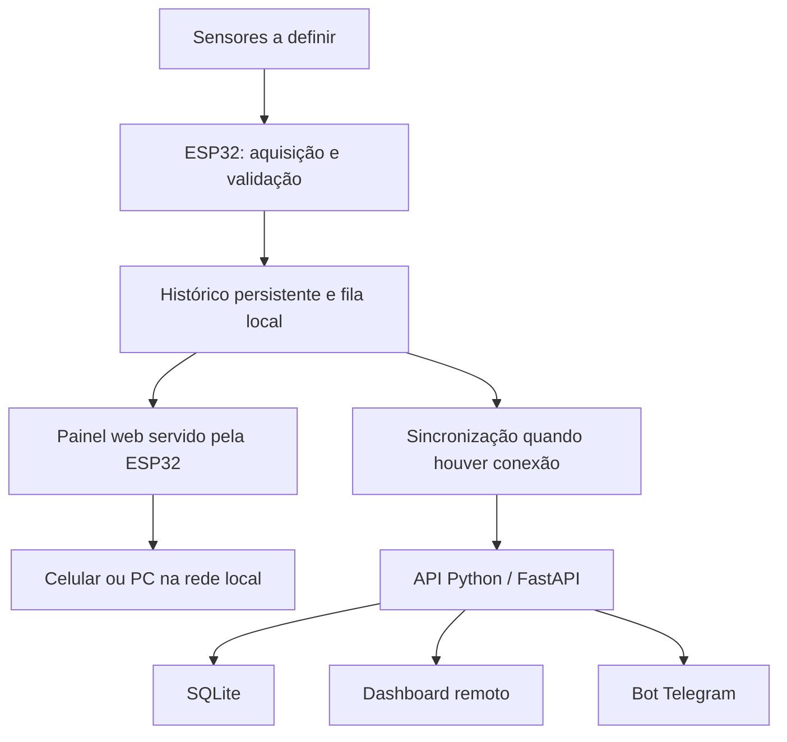

# Relatório geral e análise do projeto

Análise inicial: 12 de novembro de 2026.

**Estado em 13/11/2026:** backend MVP implementado e testes manuais validados pelo usuário; frontend com modos API e demonstração; firmware organizado em `firmware/`. Os protótipos citados abaixo como `web/` e `dashboard/` estão agora em `legacy/web/` e `legacy/dashboard/`. Consulte o [mapa de organização](ORGANIZACAO-REPOSITORIO.md) e os READMEs dos componentes para o estado atual. As seções de análise inicial mantêm os caminhos e pendências da época.

**Decisão posterior da equipe:** a topologia passa a ter nós ESP32 e uma ESP32 gateway, com API e SQLite no notebook local. O armazenamento e painel embarcados ficam no gateway. O [plano da equipe](PLANO-EQUIPE-MVP.md) e o [contrato v1](CONTRATO-API-V1.md) são as referências para a próxima integração e prevalecem sobre os exemplos anteriores de placa única e `/api/measurements` registrados abaixo.

Este documento consolida o código encontrado no repositório da equipe, o protótipo React anterior e as decisões tomadas para a próxima etapa. As funcionalidades propostas abaixo ainda dependem de implementação e validação.

O [plano do frontend adaptável](PLANO-FRONTEND-ADAPTAVEL.md) detalha a comparação das duas interfaces, os perfis de análise, a evolução do contrato para resultados numéricos, categóricos e booleanos e a migração proposta.

Atualização: a primeira interface integrada foi implementada em [frontend/](../frontend/README.md), com catálogo local de perfis e dados simulados. A aplicação estática e o protótipo anteriores permanecem preservados. Os testes existentes e o build do frontend passaram posteriormente, conforme seu README; validação visual e integração física continuam sendo etapas próprias. As seções seguintes registram a análise inicial e a arquitetura; não representam integração física concluída.

## 1. Objetivo e decisões

O projeto combina aquisição de dados no campo, consulta pelo celular e computador e interação pelo Telegram. A arquitetura escolhida é **ESP32 com armazenamento local + painel web local leve + dashboard remoto quando houver internet + bot Telegram**.

Os sensores, grandezas, unidades, frequência de coleta, calibração e limiares ainda serão definidos. A referência a umidade no protótipo React é um exemplo de simulação, sem determinar o hardware final. O uso de Telegram e dashboard está definido, e ambos já possuem implementações demonstrativas; isso não significa que a integração com medições físicas esteja concluída.

## 2. Organização dos arquivos

O repositório da equipe fica em `hackathon/PROJETO-HACKATON-2026/`. O protótipo React foi movido de `hackathon/dashboard/` para `dashboard/` dentro do repositório. O Git antigo do protótipo, sem commits, está guardado em `hackathon/dashboard-git-backup/`.

| Pasta | Papel atual |
| --- | --- |
| `bot/` | Bot Telegram Python, classificação de cores, textos, roteamento, configuração e testes. |
| `web/` | Aplicação estática com abas, calculadora, gráficos SVG, integração com Telegram e recursos de PWA. |
| `extension/` | Extensão de acessibilidade, separada da aplicação web. |
| `assets/` | Imagens de apresentação. |
| `docs/` | Guias e relatório do projeto. |
| `dashboard/` | Protótipo React anterior com leituras fictícias; agora dentro do repositório da equipe, pendente de commit. |

Para compartilhar o trabalho com a equipe, as alterações precisam estar dentro deste repositório. O guia em `../README.md` organiza o workspace local, mas fica fora do Git da equipe.

## 3. Análise do código existente

### Aplicação web da equipe

`web/js/app.js` coordena abas, seleção manual da cor, formulários e montagem da interface. `content.js` contém textos e parâmetros; `charts.js` calcula resultados a partir de constantes e desenha gráficos SVG. `telegram.js` adapta a experiência ao ambiente Telegram. Os caminhos relativos permitem manter os arquivos na mesma estrutura após mover o repositório.

Os gráficos atuais representam cenários calculados, não histórico de sensores. Não foi encontrado cliente para uma API de medições. O uso de aplicação estática permite visualizar a interface com um servidor HTTP Python, sem instalar dependências npm.

O service worker em `web/sw.js` pré-carrega arquivos e, nas consultas, tenta a rede antes de recorrer ao cache. Apesar do comentário “cache-first”, o comportamento implementado é de prioridade à rede. Esse detalhe deve ser alinhado na próxima revisão do código. Em `localhost`, `app.js` remove registros de service workers e caches da origem para facilitar desenvolvimento. Portanto, a consulta offline da versão publicada não deve ser considerada validada apenas por um teste local comum; a limpeza também merece ser restringida aos recursos da própria aplicação.

### Bot Telegram

`agrosponge_telegram_bot.py` usa polling e possui tratamento de boas-vindas, fotos, áudio, botões e perguntas de texto. O áudio recebe uma resposta orientativa; não há transcrição implementada. `roteamento.py` separa regras simples de palavras-chave e atalhos. `classificador.py` analisa a média RGB de um recorte central da foto, com resultado ambíguo quando não há correspondência às regras.

Os testes em `bot/tests/test_bot.py` cobrem exemplos de cores, ambiguidades, roteamento e constantes de conteúdo. São verificações de software; não comprovam a qualidade da água ou validade de um biossensor. A classificação de cor e os textos de laudo devem ser tratados como demonstração até validação do método físico escolhido.

O código registra explicitamente `/start` e `/ajuda`. Os demais comandos anunciados no guia de configuração precisam ser conferidos contra o roteamento: definir comandos no menu do Telegram não cria automaticamente seus handlers. Por exemplo, `/painel` não tem handler dedicado nem correspondência nas palavras-chave atuais. Os futuros `/status` e `/alertas` de medições também precisam ser implementados.

### Dashboard React anterior

`dashboard/src/main.tsx` contém cartões, gráfico temporal, alertas demonstrativos, compartilhamento e controles de cenário. `mock.ts` gera leituras na memória e exporta CSV. Não há persistência nem consulta à ESP32. Esse protótipo pode fornecer a interface de monitoramento; sua integração funcional à aplicação da equipe continua pendente.

### Infraestrutura

`bot/Dockerfile` pressupõe contexto de build em `bot/`, onde estão os arquivos copiados. A configuração de publicação deve respeitar essa pasta. O mesmo cuidado se aplica ao `web/netlify.toml`, cujo diretório publicado é relativo à configuração usada no serviço. A mudança da pasta externa não altera esses caminhos internos. Não foram executados deploys ou chamadas ao Telegram nesta revisão.

## 4. Arquitetura de evolução



A ESP32 deverá coletar e armazenar sem depender de celular ligado ou aplicativo aberto. O navegador apresenta os dados e pode calcular resumos para exibição. A API será responsável por persistência remota, validação, deduplicação e alertas. O bot consultará a API; somente a API gravará no SQLite remoto.

## 5. Funcionamento sem internet

| Condição | Comportamento previsto |
| --- | --- |
| Internet e API disponíveis | Gravação local, sincronização, dashboard remoto e Telegram. |
| Roteador disponível, sem internet | Coleta continua; painel da placa acessível pela rede local. |
| Sem roteador | ESP32 cria rede Wi-Fi própria para consulta próxima pelo celular ou computador. |
| Usuário distante, placa sem internet | Serviços remotos mostram último histórico recebido e sua desatualização. |
| Internet restabelecida | Registros pendentes são sincronizados gradualmente. |
| Sem energia na placa | Coleta para; registros já persistidos deverão sobreviver ao desligamento. |

A ESP32 suporta conexão a um roteador e criação de ponto de acesso para servir páginas, conforme a [documentação oficial de Wi-Fi](https://docs.espressif.com/projects/arduino-esp32/en/latest/api/wifi.html). A combinação dos modos precisa ser validada na placa escolhida. Nome da rede, senha e endereço local serão configurados no firmware; não se deve presumir um endereço antes dessa configuração.

O painel embarcado terá arquivos locais, sem depender de bibliotecas ou fontes externas. Será aberto diretamente no endereço da ESP32. O dashboard remoto consultará a API remota. São duas origens distintas, com identidade visual que pode ser compartilhada.

A PWA atual pode preservar conteúdo estático previamente carregado, mas isso não implementa coleta de sensores, histórico persistente na ESP32 ou sincronização. Telegram depende de internet. A senha do Wi-Fi local não transforma HTTP em HTTPS; o navegador pode mostrar aviso de conexão sem criptografia no painel local. A publicação remota deverá usar HTTPS.

## 6. Armazenamento e horário

A flash da placa poderá manter o histórico. Configurações pequenas podem usar NVS; para registros acumulados, a Espressif orienta utilizar um sistema de arquivos. Ver [documentação de NVS](https://docs.espressif.com/projects/esp-idf/en/latest/esp32/api-reference/storage/nvs_flash.html). Sistema de arquivos e partições serão escolhidos após confirmar a placa, espaço do firmware e tamanho do painel.

Exemplo teórico: 1 MiB reservado para registros compactos de 32 bytes permite cerca de 22,8 dias com um registro por minuto ou 3,8 dias com um a cada dez segundos. Metadados e reserva operacional reduzem essa capacidade. JSON ocupa mais espaço; vários sensores aumentam a taxa de registros. A capacidade final precisa ser medida.

Política proposta: remover primeiro dados antigos já sincronizados. Se o espaço contiver apenas pendências, preservar esses registros e sinalizar armazenamento cheio, suspendendo novas gravações até liberar espaço. A leitura instantânea poderá continuar, mas sem apresentar o histórico como completo. Gravações devem considerar desgaste da flash e recuperação de registros incompletos após perda de energia. MicroSD poderá ser avaliado se a retenção exigir mais espaço.

O horário de aquisição é diferente do horário de recebimento. A perda de alimentação pode eliminar a referência de tempo da placa; ver [System Time — ESP-IDF](https://docs.espressif.com/projects/esp-idf/en/latest/esp32/api-reference/system/system_time.html). Ao iniciar sem hora confiável, registrar sequência e tempo desde a inicialização, com horário absoluto desconhecido. Se for necessário manter data e hora após desligamento sem internet, avaliar RTC externo com bateria.

## 7. Contrato e sincronização propostos

O contrato precisa aceitar diferentes sensores. Exemplo fictício de uma leitura:

```json
{
  "schema_version": 1,
  "device_id": "esp32-01",
  "area_id": "area-demo",
  "boot_id": "sessao-unica-exemplo",
  "sequence": 42,
  "sensor_id": "sensor-demo-01",
  "metric": "simulated_signal",
  "value": 42.5,
  "unit": "%",
  "source": "simulation",
  "quality": "valid",
  "measured_at": null,
  "uptime_ms": 420000,
  "time_quality": "unknown"
}
```

Cada registro representa uma grandeza. Campos opcionais de leitura bruta e calibração poderão ser acrescentados. Falha de sensor deve ser um estado explícito, sem converter erro em valor zero. A API acrescentará `received_at` e validará unidade e faixa por grandeza, sem impor escala percentual a todos os sensores.

O identificador `(device_id, boot_id, sequence)` será único. A sessão muda em cada inicialização e acompanha os registros antigos no armazenamento. A sequência aumenta por registro, inclusive com vários sensores.

Fluxo de envio: persistir localmente, enviar lote limitado, validar e gravar na API, retornar confirmação individual e marcar somente os registros confirmados. Se a resposta se perder, reenviar com os mesmos identificadores. A API deduplica e sinaliza conteúdo conflitante, sem sobrescrever a medição original. Falhas geram tentativas com intervalo crescente sem bloquear coleta e painel.

Leituras atrasadas completam o histórico sem substituir a leitura atual por dados antigos. A interface distingue última coleta conhecida e última comunicação. Horários desconhecidos ou estimados são identificados como tal.

Endpoints previstos: `POST /api/measurements`, `POST /api/measurements/batch`, `GET /api/measurements`, `GET /api/status` e `GET /api/alerts`. Ainda não estão implementados.

## 8. Alertas e Telegram

Além dos recursos atuais do bot, serão necessários `/status`, `/alertas` e `/painel` conectados à API. `/start` deverá associar o chat autorizado à demonstração. Tokens ficam fora do repositório e do JavaScript dos painéis. O envio da ESP32 à API publicada usará HTTPS e autenticação por dispositivo.

As regras serão definidas por grandeza e calibração. Enquanto houver dados artificiais, mensagens e telas devem indicar simulação. O limiar de 30% pertence apenas ao protótipo anterior. A API manterá ocorrências e estado de entrega; o bot enviará avisos pela [Telegram Bot API](https://core.telegram.org/bots/api).

Ocorrências recebidas após reconexão devem aparecer como históricas, preferencialmente em um resumo atrasado. Uma condição antiga não deve ser apresentada como alerta atual. A meta será reduzir duplicações por ocorrência; falhas entre aceite pelo Telegram e confirmação local impedem prometer entrega exatamente uma vez.

## 9. Estado atual e próximas entregas

| Frente | Estado |
| --- | --- |
| Web estática, bot e extensão | Código existente no repositório da equipe. |
| Dashboard React | Protótipo separado com dados simulados. |
| Firmware e sensores | Implementação pendente; hardware e grandezas em definição. |
| Persistência na placa e painel embarcado | Planejados. |
| API, SQLite de medições e sincronização | Planejados. |
| Monitoramento pelo Telegram | Integração pendente; o bot atual atende ao fluxo demonstrativo de selos e conteúdo. |

Próximas entregas propostas: validar os componentes existentes, definir como incorporar o dashboard, implementar API com dados simulados, implementar firmware e persistência, criar painel local, integrar Telegram e escolher/calibrar sensores. A definição das medições pode avançar enquanto o software usa dados explicitamente simulados.

Critérios do ensaio completo: consulta no celular e PC; coleta sem internet; consulta pela rede da placa; recuperação após reinicialização; sincronização sem duplicar leituras; indicação de sensor com erro e armazenamento cheio; preservação de horário desconhecido; resumo de alertas atrasados. Esses ensaios físicos ainda não foram realizados.

As referências oficiais foram consultadas durante a discussão da arquitetura. As políticas aqui descritas são propostas específicas do projeto. Nesta reorganização, a mudança funcional é apenas de localização dos arquivos; comportamento de bot, web, extensão e dashboard foi preservado.

## 10. Verificação da reorganização

Os 66 arquivos da pasta original foram comparados por SHA-256 imediatamente após a movimentação, sem diferenças. Após a atualização documental, apenas o README mudou entre esses arquivos; o relatório foi acrescentado. Histórico Git e código permaneceram íntegros.

Foram conferidos sintaxe Python e JavaScript, configuração JSON, links locais dos documentos novos ou atualizados e `git diff --check`. A suíte pytest não foi executada: pytest, Pillow e NumPy não estão instalados neste ambiente. Não houve teste visual, ensaio físico ou publicação nesta etapa.
